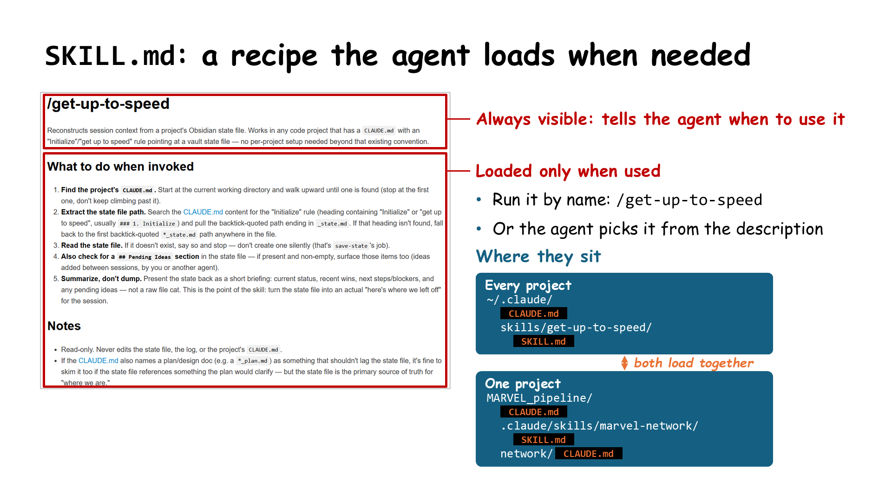

# CLAUDE.md and skills

An agent starts every session with no memory. Two kinds of plain Markdown file tell it where it is and how to do the jobs I repeat.

## CLAUDE.md: the job description

`CLAUDE.md` sits in the project folder, and the agent reads it before it does anything else. It is written for the agent, not for people.

Here is the real one from a small tool of mine that adds column headers to ExoMol data files: [exomol-headers.CLAUDE.md](../examples/files/exomol-headers.CLAUDE.md). It is copied unchanged. Only the file name differs, so an agent working in this repo doesn't load it as its own rules.

The top says what the project is and why it exists, in two short paragraphs. Then it points at a design document and says that document wins over anything the agent remembers. `CLAUDE.md` doesn't have to hold everything. It tells the agent where to look.

The operating rules say how a session starts and ends. "Get up to speed" reads my notes on the project, and "save state" writes them back. Those two phrases are skills, shown below, and the [vault memory](03-vault-memory.md) page explains the notes they read and write.

The second half is practical. A map of the folders, so the agent doesn't have to search for where things are. Where the real test data is, and what it looks like. And the one rule that everything else depends on: the original ExoMol files are never changed, and when the files disagree with their description, the agent warns instead of failing.

You don't need to write all this at once. In Claude Code, `/init` reads your code and drafts a first version. I add the state and log rules by hand on top, and they have the same shape in every project. After that, every time the agent makes the same mistake twice, I add one line. Other agents use the same idea under a different name, usually `AGENTS.md`.

### One per project, not one for everything

Every research project has its own conventions, environment and stage of maturity. A single `CLAUDE.md` for all of them either drowns in project-specific rules or stays too generic to help. With one per project, the agent only loads the rules for the folder it is sitting in.

## SKILL.md: a recipe loaded when needed

A skill is a recipe for a job I repeat. Each skill is a folder with one file in it, `SKILL.md`, plus any scripts it needs. Link to: [get-up-to-speed](../kit/get-up-to-speed.md), the skill named in the `CLAUDE.md` above:



## Where they sit

Both kinds of file sit in two places. My home folder holds the ones for every project. "Get up to speed" lives there because every project uses it:

```
~/.claude/
  CLAUDE.md
  skills/get-up-to-speed/
    SKILL.md
```

A project folder holds its own, like the network skill in my MARVEL pipeline. A subfolder can add extra rules for work in that folder:

```
MARVEL_pipeline/
  CLAUDE.md
  .claude/skills/marvel-network/
    SKILL.md
  network/CLAUDE.md
```

When I start a session in a project, both sets load together.

## Hooks

Skills fire when named, or when the agent decides the description fits. Hooks fire on their own, without being asked. Two of mine:

- [ponytail](../kit/ponytail.md) loads its full rule set at every session start, so it is always on and I never invoke it per task.
- [graphify](../kit/graphify.md) checks the diff after every git commit and rebuilds the project's knowledge graph as needed, so the graph never goes stale.

The full list of what I have installed, and what each one is for, is in the [kit](../kit/README.md).
