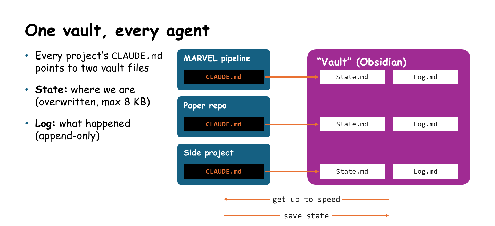

# Vault memory

Every agent session starts with no memory, so the memory lives in my Obsidian vault. The vault is my notebook and the agents' memory at the same time. This exists across most, if not all, of my long-term projects and is essential for making cross connections in my notebook too. Some people refer to this technique as the "second brain" (eurgh).[^1]



## Two trees

I keep code and notes apart.

- `C:/Code/<project>/` holds the code, one git repo per project. Each has its own `CLAUDE.md`.
- `C:/Code/Obsidian/` is the notes vault, a separate repo. It has one folder per project.

Each project's `CLAUDE.md` points at two files in its vault folder.

- **The state file**, `<Project>_state.md`, says where the project is: current status, recent wins, next steps. It is overwritten every time, and capped at 8 KB. Uncapped state files grew to 40 KB and wasted context.
- **The log**, `<Project> Log.md`, says what happened. It is append-only, and agents never read it in full.

In a project session, the agent may write only to that project's state and log in the vault, even though it can read and write anything in the code repo. The rule is in every `CLAUDE.md`: "Never change any other files within `C:/Code/Obsidian/`."

This is the state file for this repo, written by the agent at the end of the first session:

```markdown
# AI Toolkit — Claude State

**Last Modified:** 2026-11-17 21:40

**Current Status:**
- Step 1 of 8 done: repo `C:/Code/ai-toolkit` created (private on GitHub), vault project set up. The design is in [[AI Toolkit_plan]].

**Recent Wins:**
- 2026-11-17: grilling session with VaultAgent agreed the full design (layout, kit status scale, examples, copy-me guide, website integration, scrub list, build order).
- 2026-11-17: repo created with `README.md`, `CLAUDE.md` (Initialize, Log & Save, writing and scrub rules), `LICENSE` (MIT, scripts) and `LICENSE-CONTENT.md` (CC BY 4.0, text and images).

**Next Steps / Blockers:**
- Step 2: write `guide/`. Start from the site's hidden `_toolkit/01–04` (`C:/Code/Readme/mbarnfield63.github.io/_toolkit/`) and merge in the November deck material (speaker notes in the v2 and v3 sections of `02_phd/04_presentations/BarnfieldMarco_LLMDiscussion_20261117.md` on OneDrive). User reviews after step 2.
- Do not delete `_toolkit/` from the site repo until step 7.
```

## Two skills do the work

- [get-up-to-speed](../kit/get-up-to-speed.md) reads the state at the start of a session and briefs me on where we left off. The [previous page](02-claude-md-and-skills.md#skillmd-a-recipe-loaded-when-needed) shows its `SKILL.md`.
- [save-state](../kit/save-state.md) rewrites the state, appends to the log, then commits and pushes just those files in the vault repo. Because the vault is a git repo, the same state is there on every machine and for every agent.

Both are public if you'd like to copy them directly from [claude-state-skills](https://github.com/mbarnfield63/claude-state-skills).

"Get up to speed" rebuilds the context from a few hundred words, instead of the agent re-reading the whole repo.

## The cycle

At a natural stopping point, like a finished feature or a milestone, I run:

```
commit → "save state" → /clear
```

`/clear` wipes the conversation. Nothing is lost, because the state and log hold it. The next session opens with "get up to speed" and loads as much context as it needs, and no more.

This is the fix for long chats that go in circles and forget what you told them. The fix is in how the work is stored, not in prompting harder.

## I read the same notes

Because it is all plain Markdown in Obsidian, I read the same notes my agents do, with links and search.

## I have a scientific log book

Along with *plenty* of backups (please always do this anyway), I have an irrefutable record of everything I have achieved, tried, failed, archived, and spent too much time on during my PhD (and other life projects too).

[^1]: I would love to directly link to the original inspiration/source of this exact layout but I fail to remember the exact guide. Andrej Karpathy is well known as the father of the LLM Wiki architecture knowledge pattern so I guess at its core credit goes to him. [LLM Wiki Explainer Video Link](https://www.youtube.com/watch?v=n4EVksU_EOs)