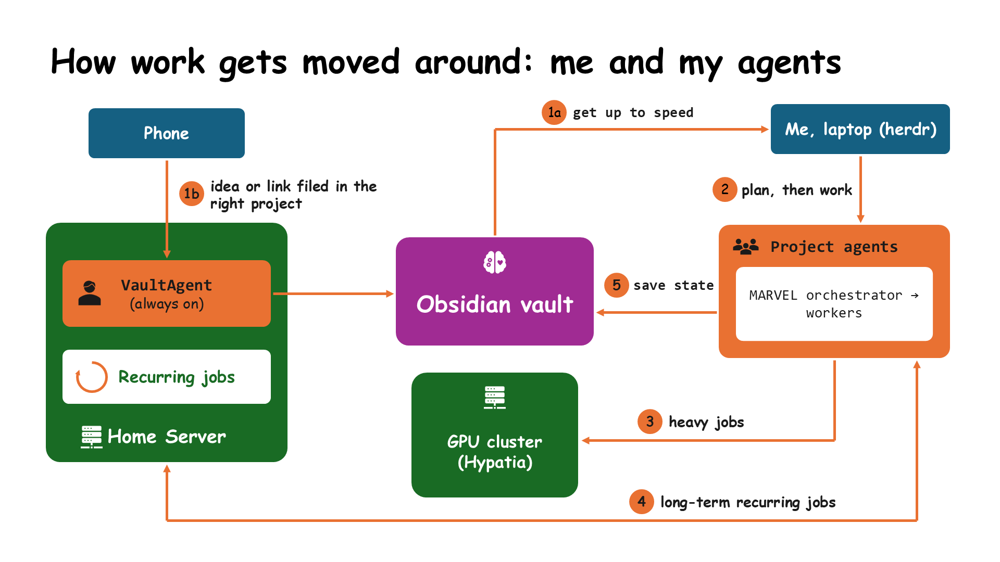

# A normal day

The vault from the [last page](03-vault-memory.md) is the hub. Nothing depends on one chat window remembering anything.

## Four(ish) steps

0. **An idea arrives.** Sometimes while away from my desk, I find a reason to message VaultAgent from my phone. This agent runs all the time on a home server through Claude Code's [Remote Control](../kit/remote-control.md) and still has access to my entire vault. In this case a project idea goes into that project's state file under "Pending Ideas". A reel can be transcribed, or GitHub link summarised into a note and filed to be used later.
1. **I get up to speed.** At my desk I open the project in [herdr](../kit/herdr.md) and use /[get-up-to-speed](../kit/get-up-to-speed.md) to trigger the skill. The agent reads the state file, and yesterday's idea is waiting there.
2. **We plan, then it works.** For anything big, I run a [grilling](../kit/grilling.md) session first. The agent asks me one question at a time, each with a recommended answer, until we agree on a plan. Then it works.
3. **Heavy jobs go to the cluster.** Jobs like OCR on scanned papers or testing new builds of ML models go to the department GPU cluster through my [hypatia](../kit/hypatia.md) cluster skills.
4. **I save state.** At a natural stopping point I use my /[save-state](../kit/save-state.md) skill. The vault gets the new state and log, and the commit is made.

NB: Claude tells you when you've used a good deal of your context, and usually suggests `/compact` to summarise the chat. I rarely do this. Instead I take it as a sign to `/save-state`, then `/clear`, then `/get-up-to-speed` to continue.

## Inside step 2

Step 2 is where most of the time goes. In more detail:

1. Launch Claude Code in the project folder and say "get up to speed".
2. Run `/grilling` with "I want to make/fix/do [idea]". Follow with a long, detailed description of what I want, or what is broken.
3. Answer lots of questions, one at a time, until we share an understanding.
4. Confirm the finished plan.
5. The agent writes the code under [ponytail](../kit/ponytail.md)'s rules, which are always on.
6. Commit the changes and say "save state". The [graphify](../kit/graphify.md) hook updates the project's knowledge graph after the commit.
7. Run the code or pipeline, then the tests. For work where the correct behaviour can be stated up front, I use [tdd](../kit/tdd.md), so the agent has a test to pass instead of "looks right". Reading the results myself matters as much: in [the question that found a bug](../examples/solver-fix.md), two questions about one table turned a routine rerun into a fix.
8. Spawn agents as needed for specific code blocks or pipeline stages, and wait for them to finish.
9. Save state again. The log gets a new entry, and the state file is replaced, so the next session starts from current context, not stale context.

## Why grill first

Clear, detailed prompts are worth the effort up front. Every vague ask costs tokens later, while the agent works out what should have been said at the start. So I interrogate large or unclear asks before any code is written, instead of leaving the model to guess in the middle of the work. This repo was planned that way: a grilling session agreed the layout, the build order and the scrub list before any page was written. The session is written up in [from a vague idea to a plan](../examples/grilling-to-plan.md).

## Choosing a model

- **Sonnet**: My daily driver.
- **Opus**: I choose by the type of task, not the size of the project. I keep it for planning very large changes or refactors, or for judging work and papers, not for "this project is important".
- **Fable**: I never use it, only because I don't pay for the credits.
