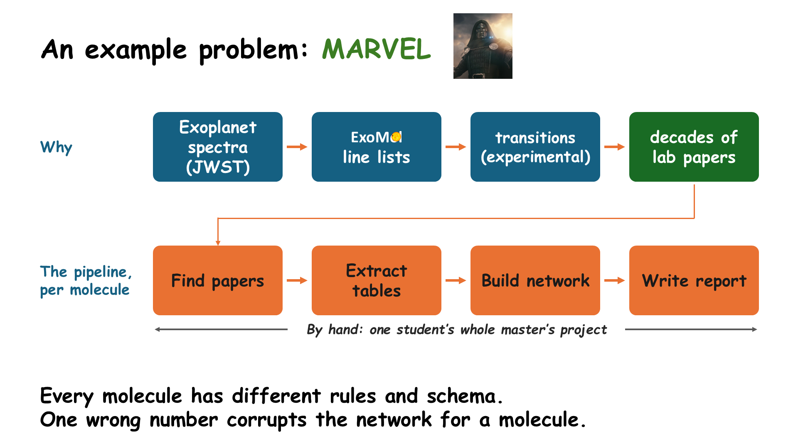
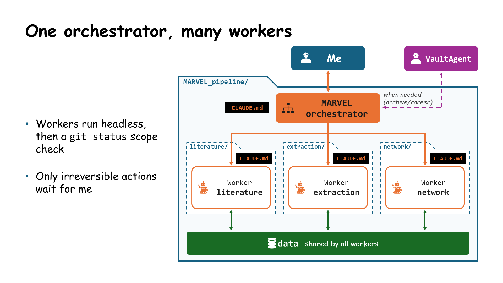

# Many agents on one project

My main project is a pipeline for MARVEL analysis. It is perhaps the easiest worked example for running many agents on one job.

## The problem

To read a molecule in an exoplanet spectrum, you need its line list, and line lists are anchored on measured energy levels. Those measurements are spread over decades of lab papers, each with its own format, labels and errors. MARVEL collects every assigned line for a molecule and builds a network: levels are nodes, lines are edges. A fit gives the best energy levels with uncertainties, and flags lines that disagree.

For each molecule the pipeline is: find every relevant paper in the literature, pull the tables out of PDFs (many of the older papers are just scans of the journal itself), build and check the network, then write it up. By hand that is months of careful reading and record keeping per molecule, hard grunt work, prone to mistakes. Therefore this job suits agents very well. I've done it in parts for 18 molecules so far...

The catch, and the benefit, is that one wrong number breaks the network: the fit throws an error. So every agent rule says "never invent a value; flag it for manual review", and scripts do every step that can be scripted. The error also lets agents check their own work. If the network breaks after a change, they know something they added is wrong.

## One orchestrator, many workers

I talk to one agent now, the orchestrator. It is the only agent that writes the MARVEL logs and its board in the vault. When something touches the rest of the vault or another project, it talks to VaultAgent.

Workers are headless `claude -p` runs (agents), one per stage and molecule: literature, extraction and network. Each stage has its own skills in the project folder (`marvel-lit-review`, `marvel-pipeline`, `marvel-network`) and can spawn its own subagents for judging papers, extracting tables and reviewing the result.[^1] The MARVEL skills are private, so the [kit](../kit/README.md) describes them without source.

Only irreversible actions wait for me.

## Why the orchestrator reads the files itself

It started differently. My general agent used to pass messages between three stage agents. It relayed about 40 messages, and its paraphrases changed counts and rules. One reworded rule would have loosened about 14,000 data lines.

So now workers read the source files and the decision ledger directly, never a summary. If a worker needs a rule, it reads the rule itself, not another agent's memory of it.

## The scope check

Permission flags on the workers block pushes and deletes. But Bash can still write anywhere. So after every worker, the orchestrator runs `git status` and reports anything outside the worker's scope.

## One day with the orchestrator

On 15 November a collaborator asked whether two dropped sources had ever been tested.

1. A worker tested three variants in a separate folder.
2. One source changed nothing. The other hid a small systematic offset, and was flagged for review.
3. The orchestrator drafted the reply.
4. I read it and sent it.

[^1]: NB: Since the individual workers aren't **subagents** of the orchestrator, they're their own headless claude instances, they *can* spawn subagents themselves. If they were subagents themselves, they could not spawn further subagents.