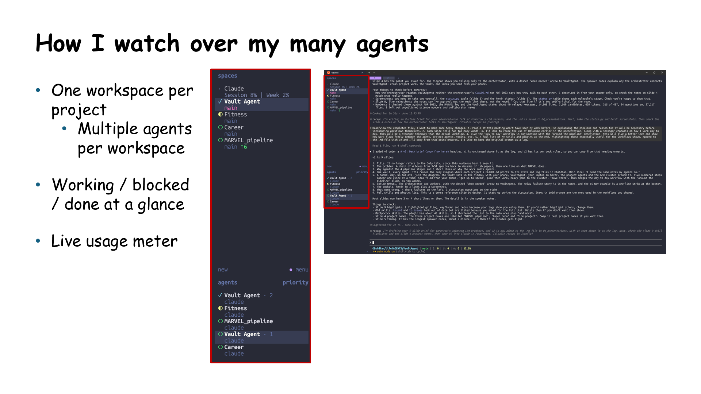

# The cockpit

With several agents running, the question becomes "which one is waiting on me?"

I use [herdr](../kit/herdr.md), a terminal multiplexer built for agent sessions. Google's new [Antigravity](https://antigravity.google/) IDE provides a similar experience from what I can tell (I haven't delved into it yet).

- **One workspace per project.** Each project has its own workspace.
- **Working, blocked or done at a glance.** A hook reports each Claude session's state, so the sidebar shows which sessions are working, blocked on a question, or done.
- **A live usage meter.** A plugin shows live Claude usage for the session and the week.
- **One key for the cluster.** One key opens a GPU cluster tab in the matching repo.
